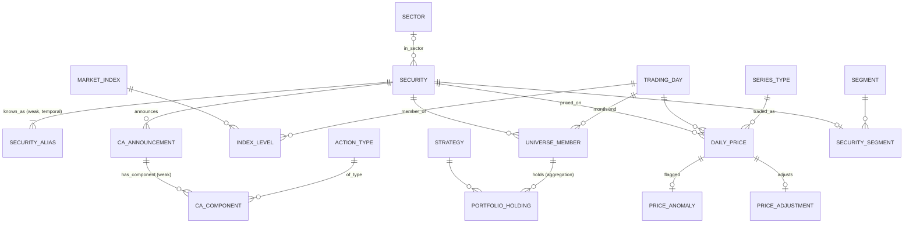

# NiftyQuant — NSE Equity Market & Momentum Research Database
### FDS Course Project (third project) · Design, Normalization & DDL

**DBMS:** PostgreSQL 18 · **Team:** 4 members · **Data:** NSE daily bhavcopy, Jan 2010 – Oct 2026, with NSE corporate actions (real, public data) · **DDL:** [02_ddl.sql](02_ddl.sql) · **Rules:** [03_logic.sql](03_logic.sql) · **Loader:** [04_load.py](04_load.py)

**Status (2026-10-29):** everything is built and verified end to end: download, schema, triggers, loader (**4,176 trading days, 3,865 securities, 7,327,332 daily prices** in one transaction, 0 rejected rows), 5 advanced queries, a rollback-only live demo, SQL statistics and the k-means notebook ([analytics/niftyquant_kmeans.html](analytics/niftyquant_kmeans.html)). Still to do: slides, report, team names.

---

## 1. Problem statement

NSE publishes one file per trading day with every stock's open, high, low, close and volume (the *bhavcopy*). Anyone can download it, and most retail backtests are built from it, but taken raw it has four problems:

- **No stable identity.** A company is a symbol in the file, and symbols change (ACKRUTI → HUBTOWN). The ISIN, the obvious key, changes too, on a stock split (BHEL got a new ISIN in 2011). Before late 2011 the files carry no ISIN at all.
- **Prices are not adjusted.** On the day of a split or bonus the price halves (or worse), and nothing in the file says why. Reliance closed at ₹2,655.70 on 25 Oct 2024 and ₹1,334.35 on the next trading day: a 1:1 bonus, not a 50% crash. NSE's "previous close" column does **not** adjust for this in either file format (we tested it, §2).
- **The universe is invisible.** The file only lists stocks that traded that day. Using today's index list for a 2012 backtest silently drops every company that later failed: survivorship bias.
- **Mixed instruments.** The equity series also carries ETFs (NIFTYBEES, LIQUIDBEES) and partly paid shares.

NiftyQuant loads 16 years of real bhavcopies into a normalized database that **resolves identities over time, adjusts prices from NSE's own corporate-action notices, and makes look-ahead bias impossible inside the database**. On top of it: a point-in-time momentum backtest in SQL, SQL statistics, and **k-means clustering of stocks by risk/return behaviour**.

### Why this data
- **It is real and official.** Bhavcopies and corporate-action notices come straight from NSE's public archives; index levels from Yahoo Finance.
- **It is large enough to matter.** 7.3 million price rows: indexes and plans show differences in milliseconds vs seconds (§8 of the demo: 3 ms vs 1,331 ms).
- **It is naturally relational, and temporal.** Security → alias spells over time; announcement → components; universe membership per month; strategy → holdings constrained by the universe.
- **It is checkable.** The Reliance bonus, the BHEL split, the Yes Bank crash of March 2020 and the June 2020 momentum crash all show up exactly where they should.

## 2. Business rules (these drive every constraint)

| # | Rule | Enforced by |
|---|---|---|
| BR-1 | A trading day is a day NSE published a bhavcopy, weekends included (budget days, Muhurat trading) | `trading_day` PK; FK from every price |
| BR-2 | On any date a symbol, and an ISIN, identifies at most one security | **GiST exclusion constraints** over `daterange(valid_from, valid_to)` |
| BR-3 | A security has one identifier spell at a time | GiST exclusion on `(security_id, daterange)` |
| BR-4 | Low ≤ open, close ≤ high; prices positive; volume and value non-negative | `CHECK`s on `daily_price` |
| BR-5 | A price exists only on a date when one of the security's identifiers was in force | **Statement-level trigger with a transition table** (checks the 7.3M-row COPY in one query) |
| BR-6 | An adjustment applies on a day the stock actually traded | Composite FK `price_adjustment (security_id, ex_date) → daily_price` |
| BR-7 | Each adjustment has one source, by precedence MANUAL > CORP_ACTION > NSE_PREVCLOSE; factor > 0 and ≠ 1 | PK + `CHECK`s; built by `refresh_research()` |
| BR-8 | A daily move beyond ±e^0.4 that no adjustment explains is an anomaly: *excluded* if a capital event was announced within 10 days, otherwise *genuine* | `price_anomaly` + `refresh_research()`; monthly returns treat excluded days as 0 |
| BR-9 | A corporate-action component carries the attributes of its type (split → share ratio; dividend → cash; only rights → issue price) | `CHECK`s + **trigger** against `action_type.changes_shares` |
| BR-10 | A universe member is a company share (not an ETF) that traded in the 10 trading days up to the month-end | **Statement-level trigger** |
| BR-11 | A portfolio can hold only a stock that was in the universe on the formation date (no look-ahead) | **Composite FK** `portfolio_holding (formation_date, security_id) → universe_member` |
| BR-12 | A holding's bucket ≤ the strategy's bucket count, and its universe rank ≤ the strategy's universe size | **Statement-level trigger** |
| BR-13 | Returns, adjusted prices and portfolio returns are derived, never base data | Views and materialized views (caches, rebuilt by `refresh_research()`) |
| BR-14 | Deleting a security deletes its prices, aliases and corporate actions; a trading day with prices cannot be deleted | `ON DELETE CASCADE` / default RESTRICT |

### What the real data taught us about the rules
Five assumptions from the first draft were **wrong**, and loading 16 years of real files exposed every one:

| First draft | What the data showed | Final design |
|---|---|---|
| "Trading days are weekdays" (`CHECK isodow ≤ 5`) | NSE traded on **21 weekend days**: Budget Saturdays (2015, 2020, 2025, 2026), Diwali Muhurat Sundays, the 2024 disaster-recovery Saturdays. Missing them created ~12,000 fake "adjustments" on the following Mondays | CHECK dropped; downloader probes every weekend |
| "The old file format's previous close is NSE-adjusted" | It isn't, in either format: Reliance's prev close on its 2024 bonus day is the unadjusted ₹2,655.70; TCS's on its 2018 bonus day is the unadjusted ₹3,514.10 | Adjustments come from **parsed corporate actions** for all 16 years; NSE's prev close is only a fallback for big unexplained gaps |
| "A symbol, once matched, is the same company" | Symbols get recycled. DTIL was Dhunseri Ventures' symbol until 2010 (since DPTL → DPL → DVL); Dhunseri Tea listed under DTIL on 2015-01-20, and the first loader linked it to Dhunseri Ventures, which was still trading as DPL that day | Identity rules never link a symbol to a security that already traded that day (BR-3); the GiST constraint caught it on the first trial load |
| "EQ series = company shares" | 379 of 3,865 "equities" are ETFs and mutual-fund units (ISIN prefix INF) | `instrument_type` from the ISIN; ETFs excluded from the universe (BR-10) |
| "Every large unexplained move is a data error" | Yes Bank (−56%, 6 Mar 2020), Infibeam, now AvenuesAI (−71%, 28 Sep 2018) and DHFL were real crashes; demergers (IDFC 2015, Siemens 2025, Vedanta 2026) are not, and NSE notices give no ratio for them | BR-8: auto-resolved from the corporate-action record; 2,127 genuine, 82 excluded |

---

## 3. Enhanced ER model

### 3.1 Entities and attributes
Notation: **bold** = key, *italic* = derived, {braces} = multi-valued.

| Entity | Type | Attributes |
|---|---|---|
| SECURITY | Strong | **security_id**, security_name, instrument_type, {aliases}, *first_date*, *last_date* |
| SECURITY_ALIAS | **Weak**, owner SECURITY | **valid_from** *(partial key)*, valid_to, symbol, isin |
| SECTOR | Strong (lookup) | **sector_id**, sector_name *(CK)* |
| SERIES_TYPE | Strong (lookup) | **series_code**, description, rolling_settled |
| TRADING_DAY | Strong | **trade_date**, file_format, *is_month_end* |
| DAILY_PRICE | **Weak**, owners SECURITY and TRADING_DAY | open, high, low, close, prev_close, volume, traded_value, num_trades, *return* |
| MARKET_INDEX | Strong (lookup) | **index_code**, index_name *(CK)*, source |
| INDEX_LEVEL | Weak, owners MARKET_INDEX, TRADING_DAY | close_lvl |
| CA_ANNOUNCEMENT | Strong | **ann_id**, ex_date, record_date, raw_subject, parse_status; *(security, ex_date, raw_subject)* CK |
| CA_COMPONENT | **Weak**, owner CA_ANNOUNCEMENT | **component_no** *(partial key)*, shares_before, shares_after, cash_per_share, issue_price |
| ACTION_TYPE | Strong (lookup) | **action_code**, description, changes_shares |
| PRICE_ADJUSTMENT | Weak, owner DAILY_PRICE | factor, source, note |
| PRICE_ANOMALY | Weak, owner DAILY_PRICE | raw_return, resolution, note |
| UNIVERSE_MEMBER | Relationship-as-entity (SECURITY × month-end) | liquidity_rank, avg_traded_value |
| STRATEGY | Strong | **strategy_id**, strategy_code *(CK)*, lookback, skip, n_buckets, universe_size |
| PORTFOLIO_HOLDING | **Aggregation**: STRATEGY × [UNIVERSE_MEMBER] | bucket, signal, *next-month return* |
| SEGMENT, SECURITY_SEGMENT | Analytics (07) | segment_name, description; distance |

### 3.2 Relationships: cardinality and participation

| Relationship | Between | Cardinality | Participation | Attributes |
|---|---|---|---|---|
| KNOWN_AS | SECURITY – SECURITY_ALIAS | 1 : N, **identifying** | Alias total | (temporal: valid_from, valid_to) |
| IN_SECTOR | SECURITY – SECTOR | N : 0..1 | Partial (only today's NIFTY 500) | — |
| PRICED_ON | SECURITY – TRADING_DAY | M : N (→ DAILY_PRICE) | Both partial | OHLC, volume, value |
| TRADED_AS | DAILY_PRICE – SERIES_TYPE | N : 1 | Price total | — |
| ANNOUNCES | SECURITY – CA_ANNOUNCEMENT | 1 : N | Announcement total | — |
| HAS_COMPONENT | CA_ANNOUNCEMENT – CA_COMPONENT | 1 : 0..N, **identifying** | Component total | — |
| OF_TYPE | CA_COMPONENT – ACTION_TYPE | N : 1 | Component total | — |
| ADJUSTS | PRICE_ADJUSTMENT – DAILY_PRICE | 0..1 : 1 | Partial | factor, source |
| MEMBER_OF | SECURITY – (month-end) TRADING_DAY | M : N (→ UNIVERSE_MEMBER) | Both partial | rank, avg value |
| HOLDS | STRATEGY – **[MEMBER_OF]** | M : N, **aggregation** | Both partial | bucket, signal |

### 3.3 EER constructs used

| Construct | Where | Why |
|---|---|---|
| **Temporal (valid-time) entity** | SECURITY_ALIAS with `[valid_from, valid_to]` | Identity changes over time; the key is "who was RELIANCE *on that date*" |
| **Weak entities** | SECURITY_ALIAS, CA_COMPONENT, DAILY_PRICE | A component means nothing without its announcement; a price nothing without its stock and day |
| **Multi-valued attribute → relation** | {aliases}; an announcement's {components} | "Bonus 1:1 / Face Value Split Rs 10 → Rs 5" is two facts in one text field (§5.2) |
| **Aggregation** | PORTFOLIO_HOLDING references the MEMBER_OF relationship | A holding is a stock *as a member of that month's universe*: the composite FK is the aggregation, and it is what forbids look-ahead (BR-11) |
| **Derived attributes** | returns, adjusted prices, month-end flag, first/last dates | Views / materialized views (BR-13) |
| **Lookup entities holding FDs** | SERIES_TYPE, ACTION_TYPE | series → settlement regime; action → changes_shares (§5.4) |

### 3.4 Diagram (relational / crow's-foot view)

## 4. ER → relational mapping (Elmasri–Navathe steps)

| Step | Applied to | Result |
|---|---|---|
| 1. Strong entities | SECURITY, SECTOR, TRADING_DAY, STRATEGY, lookups | One relation each, surrogate or natural key |
| 2. Weak entities | SECURITY_ALIAS, CA_COMPONENT | PK = owner's key + partial key; `ON DELETE CASCADE` |
| 4. 1:N | IN_SECTOR, ANNOUNCES, OF_TYPE, TRADED_AS | FK on the N side |
| 5. M:N | PRICED_ON, MEMBER_OF, index levels | Relations `daily_price`, `universe_member`, `index_level` with composite PKs |
| 6. Multi-valued | {aliases}, {components} | Own relations (step 2) |
| Aggregation | HOLDS | `portfolio_holding` with a composite FK to `universe_member` |

### Final relational schema
Underlined = PK; → = FK.

- series_type(<u>series_code</u>, description, rolling_settled)
- action_type(<u>action_code</u>, description, changes_shares)
- market_index(<u>index_code</u>, index_name, source)
- trading_day(<u>trade_date</u>, file_format)
- sector(<u>sector_id</u>, sector_name)
- security(<u>security_id</u>, security_name, instrument_type, sector_id → sector)
- security_alias(<u>security_id → security, valid_from</u>, valid_to, symbol, isin)
- daily_price(<u>security_id → security, trade_date → trading_day</u>, series_code → series_type, open_px, high_px, low_px, close_px, prev_close_px, volume, traded_value, num_trades)
- index_level(<u>index_code → market_index, trade_date → trading_day</u>, close_lvl)
- ca_announcement(<u>ann_id</u>, security_id → security, ex_date, record_date, raw_subject, parse_status)
- ca_component(<u>ann_id → ca_announcement, component_no</u>, action_code → action_type, shares_before, shares_after, cash_per_share, issue_price)
- price_adjustment(<u>(security_id, ex_date) → daily_price</u>, factor, source, note)
- price_anomaly(<u>(security_id, trade_date) → daily_price</u>, raw_return, resolution, note)
- universe_member(<u>month_end → trading_day, security_id → security</u>, liquidity_rank, avg_traded_value)
- strategy(<u>strategy_id</u>, strategy_code, description, lookback_months, skip_months, n_buckets, universe_size)
- portfolio_holding(<u>strategy_id → strategy, formation_date, security_id</u>, bucket, signal; (formation_date, security_id) → universe_member)
- *(07)* segment(<u>segment_id</u>, segment_name, description); security_segment(<u>security_id → security</u>, segment_id → segment, distance)

## 5. Normalization: from the bhavcopy row to BCNF

### 5.0 Starting point: the flat record
One row of a merged file (bhavcopy joined with the corporate-action notice and the index list):

R(trade_date, symbol, isin, series, open, high, low, close, prev_close, volume, value, trades, company_name, sector, series_description, rolling_settled, ca_subject, ex_date)

### 5.1 Functional dependencies
- FD1: (symbol, trade_date) → isin, series, open, high, low, close, prev_close, volume, value, trades
- FD2: (isin, trade_date) → symbol, … (an ISIN prints under one symbol on a day: BR-2)
- FD3: isin → company_name, sector *(not* symbol: symbols change; *not* the reverse: ISINs change on splits)
- FD4: series → series_description, rolling_settled
- FD5: (isin, ex_date) → ca_subject *(an announcement)*

Candidate keys of R: {symbol, trade_date} and {isin, trade_date} (with ex_date for the CA part).

### 5.2 1NF
`ca_subject` is not atomic: "Bonus 1:1 / Face Value Split (Sub-Division) - From Rs 10/- Per Share To Rs 5/- Per Share" is **two** actions with their own numbers. The parser splits it into `ca_component` rows (BONUS 1→2, SPLIT 1→2), and the raw text is kept once in `ca_announcement` for provenance. 22,509 announcements parse into 22,965 components (59 stay "unparsed", kept verbatim).

### 5.3 2NF: remove partial dependencies
FD3 (isin → company_name, sector) depends on part of the key {isin, trade_date}: company facts repeat on all ~4,000 of a stock's rows. → `security` (+ `sector`), and `daily_price` keeps only the day's facts.

### 5.4 3NF: remove transitive dependencies
- (symbol, trade_date) → series → rolling_settled: settlement regime is a fact about the series. → `series_type`.
- component → action_code → changes_shares: whether an action changes the share count is a fact about the action type. → `action_type`, which the BR-9 trigger reads.

### 5.5 BCNF check
Every remaining non-trivial FD has a superkey on its left: `daily_price` {security_id, trade_date}; `security_alias` {security_id, valid_from} (and the GiST constraints make {symbol, date} and {isin, date} keys *at a date*); `ca_component` {ann_id, component_no}; lookups by their codes. **All relations are in BCNF.**

### 5.6 The identity problem: why neither symbol nor ISIN can be the key
FD3 is the tricky one. Neither natural identifier is stable:
- symbol → company fails on renames (ACKRUTI and HUBTOWN are one company);
- isin → company holds, but company → isin does not (BHEL had INE257A01018, then INE257A01026 after its 2011 split), and before Oct 2011 there is no ISIN at all.

So the design introduces a **surrogate key** (`security_id`) and moves the identifiers into a **temporal weak entity** (`security_alias`) with validity ranges. The loader resolves each day's (symbol, ISIN) to a security with four ordered rules: same ISIN (R1, 6.8M rows), same symbol seen recently (R2, 0.5M), NSE's rename list (R3, 44), else new (R4, 3,865). The GiST exclusion constraints then *guarantee* the mapping is consistent: they rejected the first trial load, which had linked Dhunseri Tea (listed under the recycled symbol DTIL) to Dhunseri Ventures while both traded.

### 5.7 Deliberate non-redundancy decisions
- **Raw prices are stored; adjusted prices are not.** An adjusted price changes every time a later split happens; storing it would mean rewriting history. The factor is stored once, with its source, and returns are derived (`mv_daily_return`).
- **Materialized views are caches, not base data.** Returns over 7.3M rows are too slow to recompute per query, so `mv_daily_return` / `mv_monthly_return` cache them; `refresh_research()` rebuilds them. The demo shows a materialized view going stale and refreshing (step 6).
- **Universe and holdings are stored**, because they are *decisions as of a date*: a record of what was knowable then. They're rebuilt by the same procedure, and FKs/triggers keep them honest.

## 6. Analytics plan and findings

### 6.1 Queries ([05_queries.sql](05_queries.sql))
| Q | Question | Concepts |
|---|---|---|
| Q1 | Does momentum work in India? Decile scorecard | Window frames: running log-wealth, running peak, drawdown; UNION ALL |
| Q2 | How much would survivorship bias have flattered us? | Correlated subquery, FILTER aggregates |
| Q3 | ₹1 lakh in the winners decile, after costs | **Recursive CTE** as a loop; turnover by NOT EXISTS |
| Q4 | Stocks in the top 200 at every month-end since 2016 | **Relational division** (double NOT EXISTS) |
| Q5 | Winners-decile churn; turnarounds | **EXCEPT**, **INTERSECT** |

### 6.2 SQL statistics and k-means ([07_analytics.sql](07_analytics.sql), notebook)
A1 moments (skew, kurtosis) · A2 information coefficient (RANK + CORR) · A3 momentum crashes · A4 sector betas (REGR_SLOPE, GROUPING SETS) · A5 liquidity bands (WIDTH_BUCKET) · A6 horizon decay (CROSS JOIN generate_series, running SUM) · A7 market states (ROWS BETWEEN 12 PRECEDING AND 1 PRECEDING) · `v_stock_features` (7 features over 60 months, all in SQL) → k-means (k = 4) → `segment` / `security_segment` → S1 (sector mix), S2 (down-market behaviour).

### 6.3 Findings (from the executed notebook)
- **Momentum works, strongly.** 12-1 deciles over Jan 2011 – Oct 2026: winners **+26.3%** a year, losers **−7.0%**, NIFTY 500 **+9.9%**. Winners-minus-losers 2.34% a month, t = 4.52 (bootstrap 95% CI 1.30%–3.34%). IC 0.06, t = 4.9.
- **Weaker in large caps:** top-200 quintiles WML 13.0% a year (Sharpe 0.67) against 27.9% (1.13) for the top 500.
- **Costs matter but don't kill it:** ~27% monthly turnover; ₹1 lakh → ₹40.5 lakh gross, ₹31.2 lakh after 0.5% per rebalance, ₹4.4 lakh in the NIFTY 500.
- **Crashes come in rebounds:** June 2020 (−33.6%), January 2012, April 2020.
- **It works only after rising markets (A7):** 3.13% a month (t = 6.3) after a year in which the NIFTY 500 rose; −0.30% (t = −0.2) after a falling year, when last year's losers rebound 3.65% a month. Holding momentum only after rising years lifts the Sharpe ratio from 1.01 to 1.47 and the worst month from −34% to −18% (in-sample: the rule was chosen after seeing A7). Volatility scaling cuts the drawdown but not the worst month.
- **Not market risk:** CAPM beta −0.51, alpha 2.80% a month (t = 5.7); losers carry beta 1.75, winners 1.24.
- **Slow and shrinking (A6):** the premium fades from 2.34% in month 1 to 0.47% in month 12 without reversing (15% in total); by sub-period it fell from 2.99% (2011–15) to 2.46% (2016–19) to 1.78% a month (2020–26), significant in each.
- **Costs and the skipped month:** break-even cost 4.2% of value traded per rebalance at 27.6% monthly turnover; 12-0 and 12-1 earn the same (no short-term reversal in India).
- **Survivorship bias: 2.4 points a year** (5–7 points a year in 2011–14).
- **Fat tails:** monthly excess kurtosis 7.0. **Sector betas:** construction 1.63 … healthcare 0.87.
- **Four kinds of stock:** Momentum Leaders (88), Defensive Compounders (152), Dividend Yielders (36), Volatile Laggards (133); validated against sector, which the model never saw (χ² p ≈ 10⁻²⁷, Cramér's V 0.43). In down months Defensive Compounders and Dividend Yielders fell 4.5% vs the market's 5.2%; Volatile Laggards 7.3%.

## 7. Presentation split for 4 members (15:00)
| Member | Part | Time |
|---|---|---|
| M1 | Problem, the four data traps (§1–2), what the data taught us | 3:30 |
| M2 | EER, temporal identity, normalization to BCNF, DDL highlights (GiST exclusion, composite FK) | 4:00 |
| M3 | Loader, triggers, live demo (06_demo.sql), indexing | 3:30 |
| M4 | Momentum results, survivorship bias, k-means segments, limitations | 4:00 |

## 8. Files and run order
`data/fetch.py` (download, resumable) → `02_ddl.sql` → `03_logic.sql` → `04_load.py` (one transaction; drops and re-adds `daily_price`'s FKs around the COPY: the PostgreSQL bulk-load recipe, 25 s to validate instead of 3 lookups per row) → `07_analytics.sql` → notebook. `run_all.ps1` runs all of it.

## 9. Decisions taken
- **Universe = top 500 by trailing 6-month average traded value** at each month-end, ≥ 80% of days traded, company shares only. Survivorship-free without needing historical index lists (which NSE doesn't publish in bulk).
- **Equal weights, monthly rebalancing, price returns**, 0.5% cost only in Q3. Total returns (with dividends) are in `mv_*.tr_ret` for anyone who wants them.
- **Demergers are excluded days (return 0)**, not estimated: NSE's notices give no ratio, and inventing one would be worse.
- **Sector = today's NIFTY 500 classification**; other stocks are "unclassified". No historical sector data was invented.
- **Index levels from Yahoo Finance** (NIFTY 500 = ^CRSLDX); 486 pre-2010 rows and 3 non-NSE days dropped by the FK.
